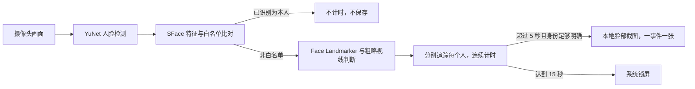

# 架构

## 从录入到常驻

1. `setup.sh` 创建项目虚拟环境，`setup_models.py` 从公开上游下载并校验模型。
2. `guard.py enroll` 录入当前使用者，把特征写入项目 `.private/owner.npz`。当前是一个登记者，不是多人名单管理器。
3. `install.py` 通过 `service.deploy(register_agent=False)` 准备独立运行副本和摄像头授权 App，再构建控制 UI；此步骤不加载后台任务。
4. 控制 UI 调用运行副本中的 `service.py start/stop`。`start` 写入并加载当前用户的登录后台配置，`stop` 禁用自启并清理残留子进程。
5. `launchd` 启动 `CameraHost.swift` 生成的原生 App。它取得用户摄像头授权后，运行 Python 监督进程，再启动 `guard.py watch`。
6. `guard.py` 输出状态心跳，控制 UI 每 5 秒读取状态；授权、断流或过期心跳不显示为正常监测。

## 检测链路

转头、眼神移开、长时间闭眼、丢帧或检测中断会清零；短眨眼暂停且不增加秒数。不同人的时间不合并。截图的身份排除条件比一般非主人分类更保守；疑似与本人接近的事件不截图。

## 主要文件

| 文件 | 作用 |
| --- | --- |
| `guard.py` | 录入、检测、逐人计时、截图、锁屏、重连与状态心跳 |
| `service.py` | 运行副本部署、登录任务、监督进程、停止和残留清理 |
| `CameraHost.swift` | 具名摄像头授权身份及 Python 启动宿主 |
| `ControlApp.swift` | 控制窗口、状态栏白字、状态读取和启动/停止按钮 |
| `build_control_ui.py` | Swift 编译、自检、本地签名和 UI App 安装 |
| `install.py` | 不启动监测的安装流程 |
| `setup_models.py` | 公开模型下载与固定 SHA-256 校验 |

## 本地数据边界

录入不保存原始照片。后台只在启用截图、判定为非本人且持续注视超过阈值时，保存摄像头中的脸部局部图；不录制视频，不截取桌面。JSON 记录时间、计时和估计结果，不保存额外的人脸特征。

源码目录和后台运行目录各有一份白名单资料。运行副本是为了避免依赖聊天/终端会话；重新录入后通过安装或启动入口更新副本。停止监测不会删除资料。需要清除时，先停止服务，再由用户自行删除对应文件和截图目录。

人脸特征、事件图片、运行日志和本机生成的 App 均被 `.gitignore` 排除，发布检查还会核对 Git 实际跟踪文件。
